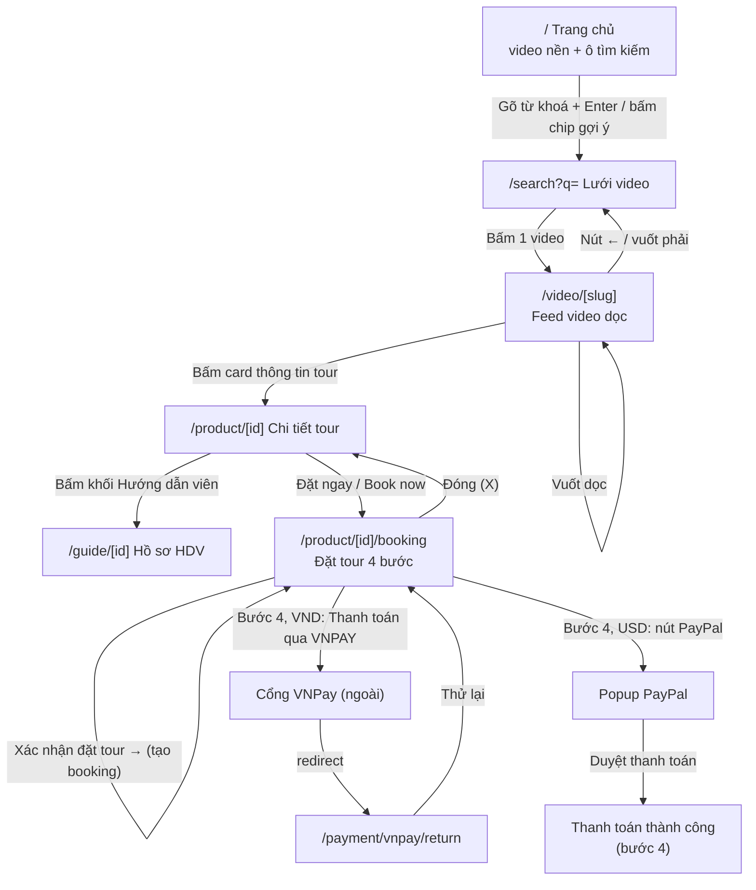
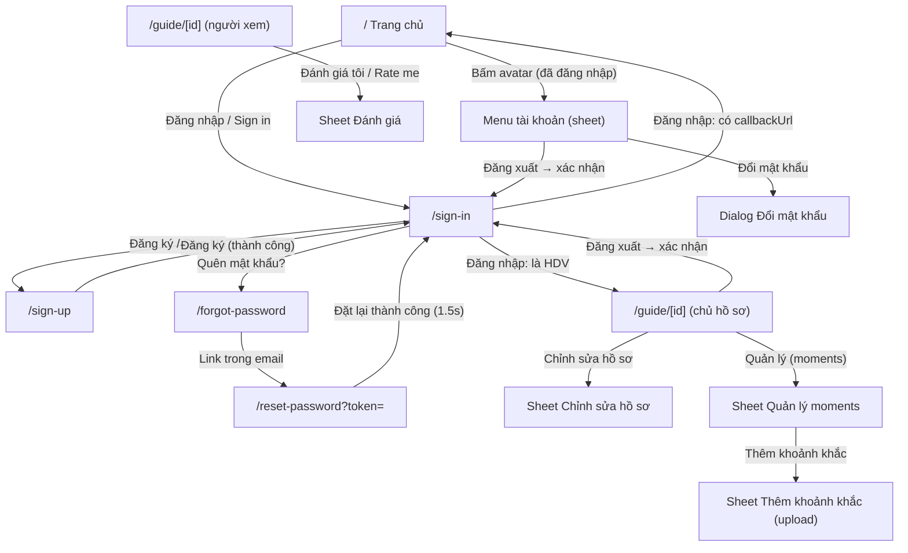

# 11 · Hướng dẫn trang CLIENT (khách & hướng dẫn viên)

Khung điện thoại 430×932, `http://localhost:3000`. Nhãn nút ghi **Tiếng Việt / English** đúng như i18n. Tài khoản test: `documents/test-accounts.local.md` (file local, không commit) — dùng `zz.client@…` (khách) và `zz.guide@…` (hướng dẫn viên).
Chi tiết kỹ thuật từng màn: [05-client-screens.md](./05-client-screens.md). Cài đặt MCP: [10-mcp-browser-testing.md](./10-mcp-browser-testing.md).

## 1. Flow khám phá → đặt tour

## 2. Flow tài khoản & hướng dẫn viên

Nút nổi **TourGuideFAB** (HDV đã đăng nhập, mọi trang trừ hồ sơ của mình) → `/guide/<tourGuideId>`.

## 3. Bảng tra nhanh: màn A → nút → màn B
| Màn A | Nút / thao tác | Màn B |
| --- | --- | --- |
| `/` | Enter trong ô tìm kiếm / chip gợi ý | `/search?q=` |
| `/` | Đăng nhập | `/sign-in` |
| `/search` | Bấm video | `/video/<slug>?autoplay=true` |
| `/video/<slug>` (mở trực tiếp / reload) | Nút Play lớn (reload gate) | Bật tiếng, cho phép cuộn |
| `/video/<slug>` | Card thông tin tour | `/product/<id>` |
| `/product/<id>` | Đặt ngay | `/product/<id>/booking` |
| `/product/<id>` | Khối hướng dẫn viên | `/guide/<id>` |
| Booking bước 1–2 | Tiếp tục → | Bước tiếp |
| Booking bước 3 | Xác nhận đặt tour → | Bước 4 (booking đã được tạo) |
| Booking bước 4 | Thanh toán qua VNPAY | Cổng VNPay → `/payment/vnpay/return` |
| `/guide/<id>` (người xem) | Đánh giá tôi | Sheet đánh giá (chưa đăng nhập → BE trả 401 khi gửi) |
| Mọi trang | Hết phiên (refresh token thất bại) | `/sign-in?callbackUrl=<trang cũ>` |

## 4. Cách dùng từng màn
| Màn | Thao tác chính | Lưu ý khi test |
| --- | --- | --- |
| Trang chủ | Chạm ô tìm kiếm → bàn phím mở, ô tìm kiếm nằm trên bàn phím; chip gợi ý | Video nền tự bật tiếng sau lần chạm đầu |
| Tìm kiếm | Lưới 2 cột, cuộn để tải thêm; chạm loa để bật tiếng **1 video** | Chỉ tìm khi bấm Enter (không tự tìm khi gõ) |
| Feed video | Vuốt dọc chuyển video; tim (like); loa; card tour | Mở link trực tiếp/reload → phải bấm Play mới cuộn được (cố ý) |
| Chi tiết tour | Xem ảnh/video, lịch trình, đánh giá; **Đặt ngay** | Tour không có session tương lai → bước 1 báo "không có lịch" |
| Đặt tour | B1 ngày + số khách + liên hệ → B2 giờ, điểm đón, gói → B3 đồng ý điều khoản → **Xác nhận** (tạo booking thật) → B4 thanh toán | Bước 3 **tạo booking thật** trên DB; không thanh toán thật |
| Đăng nhập/Đăng ký | Email tự chuyển chữ thường; mật khẩu đăng ký cần hoa+thường+số | Đăng ký HDV: tick "là hướng dẫn viên" |
| Hồ sơ HDV (chủ) | Chỉnh sửa hồ sơ (tự lưu nháp), Quản lý moments (upload ≤50MB mp4/webm/mov), QR, Chia sẻ, Đăng xuất | Tour hướng dẫn (driver.js) hiện lần đầu |
| Hồ sơ HDV (khách) | Đánh giá tôi (sao + tiêu chí + ảnh/video ≤5 file ×10MB), QR, Chia sẻ | Nút "Đặt tour với …" chưa có chức năng |
| Menu tài khoản | Đổi mật khẩu (giữ đăng nhập thiết bị này, đá thiết bị khác), Đăng xuất | — |

## 5. Mẫu câu nhờ Claude test (MCP playwright)
| Mục đích | Câu lệnh |
| --- | --- |
| Chụp khung điện thoại | "Đặt viewport 430×932, mở `http://localhost:3000/`, chụp trước và sau khi chạm ô tìm kiếm." |
| Luồng khám phá | "Test: trang chủ → tìm 'Sapa' → bấm video đầu → bấm card tour → Đặt ngay. Chụp mỗi bước, báo lỗi console." |
| Đặt tour (không tạo booking) | "Đăng nhập `zz.client`, vào tour `<id>`, đi tới bước 3 rồi **dừng, không bấm Xác nhận**. Chụp từng bước." |
| Đặt tour (có tạo booking) | "Như trên nhưng bấm Xác nhận đặt tour, ghi lại mã booking, chụp bước 4. Không thanh toán." |
| Hồ sơ HDV | "Đăng nhập `zz.guide`, mở hồ sơ của mình, chụp action bar, mở Chỉnh sửa hồ sơ và Quản lý moments." |
| Feed video | "Mở `/video/<slug>` trực tiếp, chụp màn hình reload gate, bấm Play, vuốt sang video kế, chụp lại." |
| Lỗi & layout | "Mở `<trang>`, liệt kê lỗi console, request 4xx/5xx, phần tử tràn khung 430px." |

Sau test: xoá `.playwright-mcp/`; báo lại dữ liệu đã tạo (booking, review, moment) để dọn.
