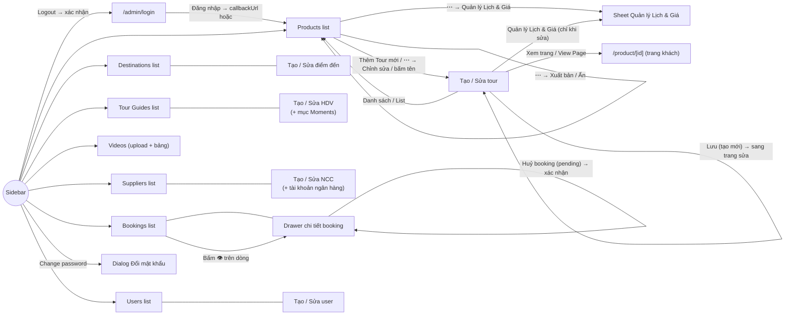

# 12 · Hướng dẫn trang ADMIN

Desktop, `http://localhost:3000/admin/login`. Nhãn nút ghi **Tiếng Việt / English** đúng như i18n. Tài khoản test: `documents/test-accounts.local.md` (local, không commit) — dùng `zz.admin@…` (role admin); chỉ dùng `admin@admin.com` (super_admin) khi cần quyền cao nhất (tạo admin).
Chi tiết kỹ thuật: [06-admin-screens.md](./06-admin-screens.md). Cài đặt MCP: [10-mcp-browser-testing.md](./10-mcp-browser-testing.md).

> ⚠ Đăng nhập cùng một tài khoản admin ở nơi khác (MCP, curl, trình duyệt khác) sẽ **đăng xuất** phiên đang mở.

## 1. Flow tổng quan

## 2. Mẫu chung cho mọi màn CRUD
| Từ | Bấm | Đến |
| --- | --- | --- |
| Danh sách | **Thêm …** (vd *Thêm Tour mới*, *Thêm Hướng dẫn viên*, *Thêm Nhà cung cấp*) | Form tạo |
| Danh sách | Bấm tên / menu **⋯ → Chỉnh sửa** | Form sửa |
| Form tạo | **Lưu** thành công | Form **sửa** của bản ghi vừa tạo (ở lại form) |
| Form sửa | **Lưu** | Ở lại form, toast thành công |
| Form | **Danh sách / List** (hỏi nếu chưa lưu) | Danh sách |
| Danh sách / Form | **Xoá** → dialog xác nhận | Danh sách (xoá mềm). Products không có Xoá → dùng **Ẩn** |
| Danh sách | Ô tìm kiếm (tự tìm sau 0.4s hoặc Enter) / bộ lọc / phân trang | Cùng màn; không có kết quả → "Không tìm thấy…" + **Xoá tìm kiếm** |

## 3. Cách dùng từng màn
| Màn (Sidebar) | Việc chính | Lưu ý |
| --- | --- | --- |
| **Products** | Lọc theo NCC/điểm đến/trạng thái/ngày; **Thêm Tour mới**; menu ⋯: Chỉnh sửa, Xuất bản, Ẩn, Quản lý Lịch & Giá | Không có xoá tour (BE chưa có API) |
| Products → **Form tour** | Các mục: Banner, Tags, Tổng quan, Cấu hình (quick facts), Trải nghiệm, Lịch trình, Lưu ý trước khi đặt, Bao gồm/Không bao gồm, Gói (options), Điểm đón, Giờ khởi hành, Đơn vị giá. Nút: Lưu nháp / Lưu thay đổi / Xuất bản / Ẩn | Trang tạo có **bản nháp** tự lưu (5s, khi đã sửa) + banner khôi phục |
| Products → **Lịch & Giá** | Tạo 1 ngày, Tạo dải ngày (≤366 ngày, chọn thứ trong tuần, bỏ qua/ghi đè trùng), Sửa, Xoá session; nhập giá từng đơn vị | Session không có giá = khách đặt 0đ → luôn nhập giá |
| **Destinations** | Tìm, thêm/sửa (tên 2–100 ký tự, mô tả), xoá | Ctrl/Cmd+Enter để lưu |
| **Tour Guides** | Thêm/sửa hồ sơ (tên, ngôn ngữ, chuyên môn, kinh nghiệm…), mục **Moments**: xem & xoá video | Xoá HDV đang gắn tài khoản → dialog cảnh báo |
| **Suppliers** | Thêm/sửa NCC; trang sửa có **Thanh toán & Tài khoản Ngân hàng** (thêm, đặt mặc định, xoá) | Danh sách tải tối đa 49 NCC |
| **Videos** | Kéo thả upload video (tus → Bunny), bảng video, copy embed URL | Không có xoá/sửa video |
| **Bookings** | Lọc (từ khoá, trạng thái, ngày, NCC, tour), 4 thẻ thống kê, bấm 👁 mở drawer: tab Thông tin / Thanh toán & lịch sử | **Huỷ booking** chỉ với `pending`, bắt buộc nhập lý do |
| **Users** | Tìm, lọc role, thêm/sửa user, **Đặt lại mật khẩu**, xoá | admin chỉ gán normal/tour_guide; super_admin gán thêm admin; không ai gán super_admin |
| Sidebar cuối | **Change password**, **Logout** | Đổi mật khẩu đá các thiết bị khác |

## 4. Mẫu câu nhờ Claude test (MCP playwright)
| Mục đích | Câu lệnh |
| --- | --- |
| Đăng nhập & chụp | "Viewport 1366×768, đăng nhập admin bằng tài khoản `zz.admin` trong `documents/test-accounts.local.md`, chụp từng mục trên Sidebar." |
| Tìm kiếm & trạng thái trống | "Ở Products, Tour Guides, Suppliers, Bookings: tìm 'zzqxnomatch', chụp trạng thái trống, bấm Xoá tìm kiếm." |
| Validate form | "Mở Users → Thêm user, bấm Lưu khi để trống, chụp lỗi; nhập email sai định dạng, chụp lại." |
| Tạo/sửa có dữ liệu | "Tạo điểm đến 'ZZ Test destination', sửa mô tả, kiểm tra vẫn ở lại form; chụp từng bước. **Không xoá.**" |
| Lịch & Giá | "Mở tour `<id>` → Quản lý Lịch & Giá, mở 'Tạo dải ngày', chụp form, **không bấm tạo**." |
| Booking drawer | "Mở Bookings, bấm 👁 booking pending đầu tiên, chụp 2 tab; mở dialog Huỷ booking rồi bấm **Giữ lại booking**." |
| Phân quyền | "Đăng nhập `zz.admin`, mở Users → sửa `admin@admin.com`, chụp trạng thái chỉ-xem/khoá role." |
| Lỗi kỹ thuật | "Ở `<màn>`, liệt kê lỗi console và request 4xx/5xx." |

Thao tác ghi (Lưu, Xoá, Huỷ, Xuất bản/Ẩn, Đặt lại mật khẩu) chỉ làm khi bạn cho phép rõ và trên bản ghi `ZZ…`. Sau test: xoá `.playwright-mcp/`, báo lại dữ liệu đã tạo.
